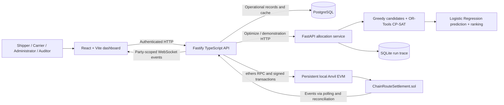
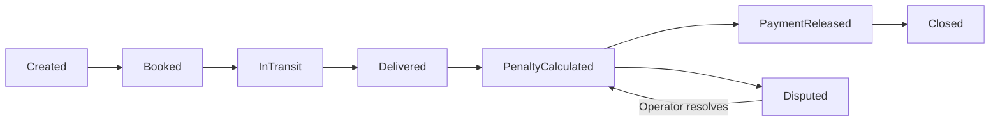

# ChainRoute: project intelligence for a six-slide SIH presentation

Research date: **27 October 2026**. Status: **content draft for approval; no final PowerPoint created**.

## 1. What can be defended

ChainRoute is a locally integrated prototype for **order-to-wagon allocation, predicted delivery reliability, and blockchain-recorded freight settlement accounting**. It connects an OR-Tools CP-SAT allocation service, a small Logistic Regression predictor, a Solidity settlement contract, PostgreSQL, a TypeScript API and a role-aware React application.

Its strongest evidence is:

- A deliberately constructed two-order/two-wagon bottleneck: the shortest-route greedy baseline serves **one order**, while the search-backed pipeline serves **both**. This is a synthetic teaching example, not a fleet-wide improvement estimate.
- A saved **6,000-example synthetic holdout**: classification accuracy **97.35%**, versus **90.92%** for always predicting on time; probability MAE **0.00978**. These are different metrics. No real railway accuracy is established.
- A recorded local end-to-end settlement: **₹25,000 freight − ₹1,500 penalty − ₹240 demurrage = ₹23,260 accounting payable**. No cryptocurrency or banking transfer occurs.
- Recorded API integration covers outage recovery, idempotency, terms-hash agreement and ledger/cache synchronization.

It does **not** yet establish full industrial rake formation, train-path scheduling, live GPS tracking, real railway prediction performance, production decentralization, commercial savings or a completely clean current browser run.

## 2. Audit scope and evidence provenance

The investigation used source, fixtures, migrations, scripts, saved logs, Git history and the supplied PDFs, rather than treating README checkmarks as proof. Application source, dependencies, databases and contracts were not changed for this research. Existing tests were inspected, **not rerun**, because the integration harness writes operational data and changes the local chain clock.

The committed baseline is `24fdea0` (`Restore freight register and add live CP-SAT and ML lab`). The working tree also contains substantial uncommitted integration, operational-clock, administration and blockchain-explorer work. Therefore, an implemented working-tree feature is not automatically a committed or freshly tested feature.

### Evidence index

Paths below are relative to the repository root; links resolve from this document.

| ID | Source and important symbols | What it establishes |
|---|---|---|
| E1 | [README](../README.md), [PRODUCT](../PRODUCT.md), [development plan](Plan.md), [decisions](decisions.md), [TDP audit](tdp-completion-audit.md) | Intended product, three tracks, phase history and design decisions; documentation may lag code. |
| E2 | [models.py](../ai-engine/models.py): `OptimizeRequest`, `Order`, `Wagon`, `Route`; [synthetic_data.py](../ai-engine/synthetic_data.py) | Actual request fields, compatibility assumptions and dataset generation. |
| E3 | [allocator.py](../ai-engine/allocator.py): `build_allocation_plan`, `_build_allocation_plan`, `_build_candidate`, `STRATEGIES`; [search_agent.py](../ai-engine/search_agent.py): `build_search_candidates`, `_objective_terms`, `_exclude_solution` | Greedy candidates, integer model, priority handling, bounded search, clock translation and alternatives. |
| E4 | [ranking.py](../ai-engine/ranking.py): `normalize_weights`, `calculate_metrics`, `rank_candidates`, `maximum_possible_cost_paise` | Exact plan metrics, synthetic cost and final ranking. |
| E5 | [training](../ai-engine/train_prediction_model.py): `generate_training_data`, `train_model`; [prediction](../ai-engine/prediction.py): `apply_candidate_predictions`; [model artifact](../ai-engine/on_time_model.json) | Simulator, fitting configuration, inference, fallback, coefficients and version. |
| E6 | [evaluation/demo script](../ai-engine/demonstrate_ml.py), [saved ML evidence](../ai-engine/demo/evidence.json), [teaching service](../ai-engine/demonstrations.py): `run_demonstration` | Frozen evaluation and live teaching requests; demonstration is inference, not retraining. |
| E7 | [scarce fixture](../samples/phase-6-scarce-demo.json), [ranking tests](../ai-engine/test_ranking.py), [invariant tests](../ai-engine/test_allocator.py), [prediction tests](../ai-engine/test_prediction.py), [trace tests](../ai-engine/test_run_log.py), [operational-clock tests](../ai-engine/test_operational_clock.py) | Toy comparison, 25-order/300-order cases, constraints, timing assertions and clock behavior. |
| E8 | [ChainRouteSettlement.sol](../blockchain/contracts/ChainRouteSettlement.sol): `createAgreement`, `confirmBooking`, `updateShipmentStatus`, `confirmDelivery`, `releasePayment`, `closeContract`, `raiseDispute`, `resolveDispute` | Actual state machine, accounting math, events and on-chain authorization. |
| E9 | [contract API](../backend/src/contracts/routes.ts), [chain adapter](../backend/src/contracts/chain.ts): `canonicalJson`, `submitTransaction`; [sync](../backend/src/contracts/sync.ts) | Plan acceptance, canonical terms hash, signing, queue, event replay and reconciliation. |
| E10 | [auth](../backend/src/auth/plugin.ts), [passwords](../backend/src/auth/password.ts), [accounts](../backend/src/auth/accounts.ts), [authorization](../backend/src/auth/authorization.ts), [session](../backend/src/auth/session.ts) | Signup, invitations, password hashing, token lifetime and role enforcement. |
| E11 | [order/plan API](../backend/src/orders/routes.ts), [platform API](../backend/src/platform/routes.ts), [dashboard summary](../backend/src/dashboard/routes.ts), [ML proxy](../backend/src/ai/routes.ts), [migrations](../backend/migrations/) | Persistence and operational workflows, endpoint behavior and overview defect. |
| E12 | [AppRoutes](../dashboard/src/app/AppRoutes.tsx), [OrdersPage](../dashboard/src/app/OrdersPage.tsx), [OptimizationPage](../dashboard/src/app/OptimizationPage.tsx), [AiLabPage](../dashboard/src/app/AiLabPage.tsx), [ContractsPage](../dashboard/src/app/ContractsPage.tsx), [RecordsPages](../dashboard/src/app/RecordsPages.tsx), [AdminResourcesPage](../dashboard/src/app/AdminResourcesPage.tsx) | Actual screens, navigation, actions, saved plans, export and role presentation. |
| E13 | [explorer backend](../backend/src/platform/blockchain.ts): `registerBlockchainExplorer`; [BlockchainPage](../dashboard/src/app/BlockchainPage.tsx), [blockchain styling](../dashboard/src/app/blockchain.css) | Real local block-header display, animation/replay and development-only block creation. |
| E14 | [Compose](../docker-compose.yml), component package/requirements files, [deployment](../blockchain/scripts/deploy-track2.js), [run guide](frontend-demo.md) | Local service topology, installed technologies, persistence and deployment configuration. |
| E15 | [integration runner](../scripts/integration-flow.cjs), [integration harness](../scripts/validate-integration.ps1), [acceptance harness](../scripts/validate-acceptance.ps1), [browser harness](../scripts/browser-acceptance.cjs); local reports in `artifacts/integration/` | What the recorded executions actually checked. Reports are local ignored evidence, not guaranteed available in a fresh clone. |

The plan cites an SRS and Technical Design v1.0; those original documents are not checked into the repository. Their complete requirements cannot be independently reconstructed from phase labels alone.

## 3. Original SIH inspiration and scope mapping

The official [SIH 2025 problem portal](https://sih.gov.in/sih2025PS) returned HTTP 403 during research. The complete official problem card, deliverables and evaluation criteria could not be read.

The primary institutional [CUTM SIH 2025 report, page 1](https://cutm.ac.in/wp-content/uploads/event/2025/Internal%20Hackathon%20SIH%202025%20Report.pdf) corroborates this title and context:

**Design and develop an AI/ML-based Decision Support System for optimizing rake formation strategies for SAIL, with the initial implementation focused on movements from Bokaro Steel Plant to CMO stockyards and customer locations.**

SAIL is corroborated as the beneficiary; the exact issuing ministry/department fields are unverified. A [grand-finale report from the SVCET nodal institution](https://triumph.srivenkateshwaraa.edu.in/SMART-INDIA-HACKATHON-HELD-AT-SVCET-ON-8-AND-9TH-DECEMBER-2025) also describes the software rake-formation problem. Public participant accounts associate it with **SIH25208**, but this is **not verified against the official card**. Leave the submission ID and official theme blank until confirmed. The supplied user description is the working requirements reference.

| Original inspiration / working need | Implemented ChainRoute behavior | Project's additional contribution | Remaining scope gap |
|---|---|---|---|
| Rake planning for steel dispatch | Compatible wagons assigned to individual orders | Explainable candidate comparison and saved run evidence | No rake/train grouping entity, minimum rake size, length or axle-load constraints |
| Bokaro → CMO/customer movements | Generic origins/destinations and direct route options | Administrator-maintained route/wagon records | Synthetic `Yard-0`, `Port-A` etc.; no verified Bokaro/CMO operational dataset |
| Capacity, quantity, priority, deadlines | Capacity coverage, no wagon reuse, priority tiers, deterministic ETA feasibility | Configurable ranking of cost, utilization and predicted reliability | No loading queues, inventory/production integration or time-expanded train timetable |
| Decision support | Plan, alternatives, unassigned explanations and what-if snapshots | Order → accepted plan → agreement integration | No planner field study, external-machine acceptance or industrial benchmark |
| Trusted contractual operations | Not established as an original SIH requirement | Solidity lifecycle, deductions, dispute hold and accounting release | Blockchain is explicitly **our extension**; no physical-event oracle or real funds |

CUTM's internal judging rubric must not be presented as the national SIH evaluation rubric. Industrial constraints listed as gaps here are assessment questions, not invented quotations from an inaccessible official card.

## 4. Verified architecture and actual user journey



There is no direct AI-to-blockchain call and no autonomous blockchain-to-AI callback. The backend owns the integration boundary. Browser REST requests use the frontend `/api` proxy; backend route definitions do not include that proxy prefix.

1. A public registrant becomes a **Shipper**. An Administrator issues a single-use invitation for Carrier, Auditor or Administrator access. Local wallet mapping is a separate administrator step where contract participation needs it.
2. The Shipper creates owned freight orders and requests optimization using current available wagons/routes and chosen weights.
3. The API snapshots inputs; the AI returns a plan, metrics, alternatives, unassigned reasons, run ID and model provenance. PostgreSQL stores immutable planning records; SQLite stores the AI trace.
4. The Shipper compares/exports the plan or runs a saved-snapshot what-if. Accepting an eligible, nonexpired plan supplies commercial terms and an active Carrier address.
5. The backend derives wagon count and the earliest assigned-order deadline, hashes the normalized terms and sends the operator-signed agreement transaction. Acceptance/idempotency prevents duplicate contracts.
6. The assigned Carrier books, dispatches, records milestones/arrival and confirms delivery with a timestamp and POD reference.
7. Solidity evaluates SLA lateness and holding charges. Either party may dispute deductions. The operator/Administrator resolves the dispute, records accounting release and closes the contract.
8. Events update the PostgreSQL cache and party notifications. An Auditor can inspect permitted history; API commercial fields are redacted for nonparties.

## 5. AI inputs, synthetic data and exact problem boundary

| Input | Actual fields / use |
|---|---|
| Order | `orderId`, `cargoType`, `quantityTonnes`, `destination`, priority **1–3** (1 highest), UTC deadline |
| Wagon | `wagonId`, `capacityTonnes`, `wagonType`, `location`, `available` |
| Route | `routeId`, `origin`, `destination`, `distanceKm`, `transitTimeSeconds` |
| Preferences | Nonnegative `onTime`, `cost`, `utilization` weights; optional `timeBudgetSeconds` |
| Clock | Working-tree `planningStart`; absent means the fixed teaching epoch **2026-01-07 20:00 UTC** |

Orders do not specify an independent origin; route eligibility and the wagon's location supply the origin. Compatibility is a fixed mapping: grain → covered, coal → open, steel → flat. Route costs are **computed**, not supplied railway tariffs. A selected order uses one predefined direct route and one or more exclusively assigned wagons. It is either fully covered or unassigned; there is no partial split across routes.

The generator uses seeded synthetic orders, standard 20-tonne wagons, four generic destination/route profiles, priorities and comfortable/tight/impossible deadlines. Default sample fixtures contain **25 orders, seed 1**. Capacity scenarios deliberately create plentiful versus scarce inventories. No actual SAIL production, wagon turnaround, historical delays, demand forecasting, vessel allocation, graph route discovery or loading-bay data is present. Scheduling currently means **a common departure plus fixed route transit time**, not optimization of train departure slots.

The current operational-clock implementation translates deadlines into the fixed internal coordinate system and translates returned departures/ETAs back. This preserves time differences without mutating a shared global clock. It does not make the model trained on operational data. [E2, E3, E7]

## 6. Exact allocation and CP-SAT formulation

### Pipeline and rationale

`STRATEGIES` builds four deterministic greedy candidates: normal priority/deadline order with shortest routes, deadline-first, smaller-wagon preference and faster-route preference. The normal candidate supplies Boolean hints to CP-SAT. All greedy candidates remain available as fallbacks.

CP-SAT fits the implemented Boolean assignment/compatibility/capacity problem and integer constraint representation. This is an engineering rationale, **not evidence of a benchmark proving superiority to Genetic Algorithms or other solvers**. Integer constraints and solution-status meanings are documented by [OR-Tools](https://developers.google.com/optimization/cp/cp_solver). [E3]

### Variables and hard constraints

Let orders be `i`, routes `r`, wagons `w`, quantities `q_i`, capacities `c_w`, and `N` the number of input orders. Create:

- `a_i ∈ {0,1}`: order served.
- `y_ir ∈ {0,1}`: route selected for the order.
- `x_irw ∈ {0,1}`: wagon allocated to that order/route.

Route variables exist only for matching destinations with `t0 + transit_r ≤ deadline_i`. Wagon variables exist only for available, compatible wagons located at that route's origin. With `K = 1,000,000`, the code imposes:

```text
sum_r y_ir = a_i
x_irw <= y_ir
y_ir <= sum_w x_irw
sum_rw floor(K * c_w) * x_irw >= ceil(K * q_i) * a_i
sum_ir x_irw <= 1                       for each wagon w
```

Empty eligible sets force the order unassigned. Capacity rounds conservatively. Deadline feasibility is a route filter, not a departure-time decision variable. The exclusivity constraint applies within one plan; it is not a multiday wagon circulation model. [E3: `build_search_candidates`, `_route_is_feasible`, `_capacity_units`]

### Search objective, including actual scaling

Define normalized weights `wT,wC,wU` summing to one. All-zero weights become equal thirds in the engine; the UI asks for a nonzero total. Let:

```text
M = 1,000,000
B = 6*M + 1
k_1 = B*(N+1)^2; k_2 = B*(N+1); k_3 = B
A = sum available-wagon capacities
Cmax = round_half_up(250 * max_route_distance * number_of_available_wagons)
slack_ir = max(0, deadline_i - (t0 + transit_r))
h_ir = 0.5 + 0.5 * slack_ir / (slack_ir + transit_r)
```

Here `250` means **paise per wagon-kilometre**, an assumed ₹2.50 cost model. Using Python's `round` for the objective coefficients, maximize:

```text
sum_i   [k_priority(i) + round(M*wU*q_i/A)] * a_i
+ sum_ir  round(M*wT*h_ir/max(1,N)) * y_ir
- sum_irw [round(M*wU*c_w/A)
           + round(M*wC*(250*distance_r)/Cmax)] * x_irw
```

Capacity terms with `A=0` and cost terms with `Cmax=0` are omitted. Priority coefficients dominate lower-tier assignment counts and the smaller metric terms. **The search objective uses `h_ir`, a deterministic slack heuristic, not the learned Logistic Regression probability.** The utilization surrogate discourages excess selected capacity; it is not the same formula as final utilization percentage. [E3: `_objective_terms`; E4]

### Search, alternatives, priority and final ranking

The solver has one worker, seed 0, default search budget **1 second**, request bounds **0.05–10 seconds**. Operational dashboard requests use 5 seconds; teaching requests can differ. At most four search candidates are obtained within the shared budget. The code accepts both `FEASIBLE` and `OPTIMAL` statuses and excludes the exact Boolean assignment before trying another. The exclusion is:

```text
sum(previously_true_variables) - sum(previously_false_variables)
    <= number_of_previously_true_variables - 1
```

This is bounded alternative search, not exhaustive enumeration. `UNKNOWN`/timeout contributes no new candidate; greedy results remain. The response does **not** expose solver status, bound or optimality gap, so a returned plan is not a certificate of global optimality.

Before ML scoring, retain only candidates with the best lexicographic served-count tuple `(priority1, priority2, priority3)`. Learned probabilities are then attached, metrics recalculated, duplicate allocation signatures removed and candidates ranked. With coverage `C = served_orders/N`:

```text
U = assigned_tonnes / selected_wagon_capacity             (0 if none)
P = sum(predicted_probability_of_each_assigned_order) / N  (unassigned count zero)
cost = round_half_up(250 * sum(distance_r * selected_wagon_count_for_order))
E = clip(1 - cost/Cmax, 0, 1)                             (0 if Cmax=0)
score = C + (wT*P + wC*E + wU*U)/(N+1)
```

Ties use assignment count, then a deterministic allocation signature. The winner and up to three alternatives are returned. Since ML reranks a finite candidate set, this is **ML-informed selection among feasible candidates**, not a globally solved learned stochastic objective. [E3: `_build_allocation_plan`; E4: `rank_candidates`]

Unassigned reasons distinguish missing routes, unknown/incompatible cargo/wagons, deadline infeasibility and insufficient compatible capacity. Capacity scarcity can produce a partial plan with explicit unserved orders; it need not fail the entire request. The displayed distance is the sum of selected route distances per order, not fleet wagon-kilometres. Displayed utilization is selected-capacity fill, not utilization of the entire available fleet.

## 7. Logistic Regression: training, inference and evaluation

### What is learned

The predictor estimates `P(on time)` for a proposed assignment. The two features are:

1. `s = (deadline - departure - planned_transit)/planned_transit`, clipped to `[-10,10]` at inference.
2. Assumed cargo transit variability `v`: grain **0.10**, coal **0.20**, steel **0.30**.

Distance, tonnage, weather, live congestion and wagon utilization are **not independent learned features**. There is no feature scaler, neural network, embedding, online learning or Genetic Algorithm in this implementation. [E5]

### Exact synthetic training procedure

`generate_training_data()` uses seed **42** and **30,000** observations. It samples `v` from the three fixed values and `s` from a triangular distribution `[-0.99,10]` with mode 0. For:

```text
sigma = sqrt(log(1 + v^2))
F = exp(Normal(0,sigma) - sigma^2/2)
y = 1 if F <= 1+s, else 0
q = NormalCDF((log(1+s) + sigma^2/2)/sigma)
```

`y` is the simulated binary outcome, while `q` is the simulator's analytically known probability. A stratified, seeded 80/20 split produces **24,000 training / 6,000 test** examples. The model fits `y`, not `q`.

The code uses `LogisticRegression(C=1000.0, max_iter=1000, random_state=42)` in scikit-learn **1.6.1**. Defaults include `lbfgs`, L2 regularization and an intercept; there is no class weighting or hyperparameter search. Defaults are corroborated by the [matching version's documentation](https://scikit-learn.org/1.6/modules/generated/sklearn.linear_model.LogisticRegression.html). The trained coefficients are exported to JSON, so inference does not refit the estimator. [E5]

### Exact inference and provenance

```text
z = 0.08926747689743683
    + 7.7953638710017445*s
    - 0.1665554777286779*v
p = 1/(1+exp(-z))              implemented with stable positive/negative branches
modelVersion = logreg-fd10e2acfde0639b
trainingDataHash = sha256:b7a614214577ab84d4ea1d96ba35b87abe1e113b76e19676f134761aac99eff4
```

The version is content-derived from training metadata and coefficients. Missing model or unseen cargo uses the labelled slack heuristic fallback; metadata distinguishes model/fallback/mixed behavior. The SQLite run record retains input hash/snapshot, run/plan IDs, timestamps, total duration, algorithm parameters, model version, counts and failure information. It is traceability, not model retraining. [E3, E5; `ai-engine/run_log.py`]

### Recorded metrics and interpretation

The training artifact and separately frozen demonstration evaluation agree to floating-point precision. The latter was recorded **21 October 2026**, uses threshold **0.5**, and reports:

| Metric | Value | Meaning |
|---|---:|---|
| Probability MAE | **0.00977554** | Mean absolute difference between predicted `p` and simulator probability `q` |
| MAE acceptance tolerance | **0.10** | Developer-set validation gate; not an industry standard or confidence bound |
| Brier score | **0.01917575** | Mean squared probability error against binary outcomes `y` |
| Classification accuracy | **97.35%** | Correct thresholded labels out of 6,000 |
| Always-on-time baseline accuracy | **90.9167%** | Majority-class comparison, not a trained competing model |
| Accuracy difference | **6.4333 percentage points** | Difference from that baseline |
| On-time precision / recall | **98.1805% / 98.9184%** | Positive class is on-time |
| Late recall | **81.6514%** | 445 of 545 simulated late examples identified |
| F1 / ROC-AUC | **Not reported** | Do not add invented values to the deck |

Confusion matrix, with actual classes as rows:

| | Predicted on time | Predicted late | Total |
|---|---:|---:|---:|
| Actual on time | 5,396 | 59 | 5,455 |
| Actual late | 100 | 445 | 545 |
| Total | 5,496 | 504 | **6,000** |

For a grain teaching assignment, slack ratios 0, 0.25 and 0.5 produce approximately **51.81%, 88.30%, 98.15% on-time probability** in the recorded examples. Those are individual predictions, not three accuracy scores.

All training and test data come from the **same simulator**. High class imbalance, only two assumed features, no temporal/external validation and no real railway outcomes limit generalization. MAE 0.0098 must never be called **99.02% accuracy**. The simulator is independent of the fitted classifier but not evidence of deployment calibration. [E5, E6]

## 8. Optimization results: what the numbers really show

### Strongest understandable allocation example

In [the saved scarce case](../samples/phase-6-scarce-demo.json), two equal-priority 20-tonne grain orders share a bottleneck wagon. The flexible order can use Yard-A or Yard-B; the second order can use only Yard-B. Both deadlines allow either route.

| Result | Greedy shortest route | Search-backed pipeline |
|---|---:|---:|
| Orders served / unserved | **1 / 1** | **2 / 0** |
| Flexible order | Yard-B, 10 km / 1 h | Yard-A, 20 km / 3 h |
| Restricted order | Unassigned | Yard-B, 10 km / 1 h |
| Selected capacity fill | **100%** | **100%** |
| Synthetic cost | **₹25** | **₹75** |

The allocation assertions are in `test_ranking.py`; the teaching endpoint uses the same allocator/predictor. This deliberately demonstrates preserving a scarce resource for the order that has no alternative. It does **not** show lower cost or a utilization-percentage improvement: more freight is served at greater total synthetic cost.

The historical README **0.490 → 0.958** values reconstruct as **0.489583 → 0.958333** from the Phase 6 slack heuristic and division by **all input orders**, including unassigned ones as zero. The fixture saves the expected assignment/routes, not those exact numeric metrics. The values predate learned reranking; they are not current Logistic Regression accuracy or an observed delivery improvement. Prefer **1 of 2 → 2 of 2 orders served** on the slide. [E3, E4, E7]

### Larger scenarios and timing

- `test_allocator.py` checks 25-order allocation invariants over **50 seeds × two capacity regimes**. This is synthetic constraint validation, not an industrial allocation-quality benchmark.
- The 300-order plentiful test uses seed 11 and asserts whole-call duration **under 20 seconds**. The 300-order scarce trace test asserts the same bound and checks order accounting/logging.
- README records historical full-pipeline measurements **7.056 s plentiful / 3.274 s scarce**, seed 11. No separately preserved per-run benchmark output was located to bind those exact measurements to the current tree. Treat them as **historical README-reported timings**, not fresh measured guarantees.
- The 300-prediction test asserts **under 0.25 s**; README's **0.0010 s** is a historical recorded claim, not a fresh measurement in this audit.
- The CP-SAT budget bounds search work, **not** baseline generation, prediction, serialization, validation, persistence or HTTP wall time. Do not promise a one-second total response.

Recommendation: lead with the toy assignment count and the qualified frozen ML result; keep performance thresholds and historical timings in notes. [E7, README]

## 9. Blockchain implementation and exact settlement

### Framework and lifecycle

The contract is **`ChainRouteSettlement`**, compiled with Solidity **0.8.28**. Hardhat **2.22.17** supplies the development/test tooling; ethers supplies backend transactions. Current working-tree Compose runs pinned persistent **Anvil 1.8.1**, chain ID **31337**, rather than Ganache or Hyperledger Fabric. Older Hardhat-node descriptions are stale for that Compose setup. Deployment can reuse verified bytecode/operator; state/block preservation is configured in the local node. [E8, E9, E14]



`confirmDelivery` records delivery and moves through Delivered into PenaltyCalculated within the same transaction. Shipment milestones are Dispatched, CheckpointReached and ArrivedAtDestination. Delivery timestamp checks enforce ordering and reject future chain timestamps; they do not prove that a physical delivery occurred.

The immutable operator creates agreements, resolves disputes, releases accounting payment and closes contracts. The assigned Carrier books and records shipment/delivery. A party can dispute before release; outcomes uphold deductions, waive penalty or waive all. The browser's Shipper acceptance causes a **backend operator-signed** creation transaction, not a Shipper wallet signature. [E8, E9]

### Chain versus database

| On-chain | Off-chain |
|---|---|
| Contract/plan reference, party addresses, commercial terms, terms hash, state, milestones/delivery/POD reference, deductions, released accounting amount, dispute/state events and hashed history | Credentials/invitations, complete orders and assignment snapshots, routes/wagons, ML artifact and run trace, operational audit, queued writes, event cursor/cache, formatted reports |

The backend computes `keccak256(canonicalJson({planId, shipper, carrier, terms}))` after normalizing terms and deriving the wagon count/deadline. PostgreSQL/API/on-chain hash equality is checked in integration. This commits the named terms and plan reference; **it does not hash the full allocation payload or prove plan optimality**.

API Administrator/Auditor responses omit private commercial fields for nonparties. Nevertheless, **plaintext on-chain terms are readable by an RPC-capable observer**. Interface redaction is not ledger confidentiality. [E8, E9, E11]

### Exact monetary rules

Let `F` be integer paise freight, `b` basis points per penalty block, `d` seconds per block, `L` late seconds, `H` held seconds, `f` free holding hours, `W` wagon count and `r` paise per wagon-hour:

```text
late_blocks = ceil(max(0,L)/d)
penalty_per_block = floor(F*b/10000)
P = min(F, late_blocks * penalty_per_block)
billable_hours = ceil(max(0,H - 3600*f)/3600)
D = min(F-P, W * billable_hours * r)
net = F-P-D
```

The implementation guards overflow and caps deductions. With no recorded destination arrival, holding demurrage is zero. `H` is delivery timestamp minus recorded arrival. Penalty time blocks are contractual windows, **not blockchain block counts**. [E8: `_calculatePenalty`, `_calculateDemurrage`]

Verified local reference vector:

| Item | Calculation | INR |
|---|---|---:|
| Freight | 2,500,000 paise | **₹25,000** |
| Penalty | 13 h late → ceil(13/6)=3 windows; 200 bps × ₹25,000 = ₹500/window | **₹1,500** |
| Demurrage | 10 h held − 6 h free = 4 h; 12 wagons × 4 × ₹5 | **₹240** |
| Net accounting payable | 2,326,000 paise | **₹23,260** |

The on-time integration case has zero deductions and **₹25,000** net. Delivery confirmation calculates deductions on-chain; accounting release still requires the explicit operator transaction. `releasePayment()` records amounts/events, with **no ETH/ERC-20 transfer, escrow funding or bank integration**. [E8; E15 local `report.json` and `shipper-settlement-1280.png`]

### Why blockchain, and what it costs

The defensible benefit is deterministic, inspectable lifecycle and deduction rules with hash-linked transaction/event evidence shared across the workflow. A conventional database is simpler for a single trusted operator; independently governed participants could gain a shared verification surface from a properly governed ledger. This prototype only demonstrates that mechanism locally. A single controllable development node, unlocked development wallets, backend-controlled signing, manual delivery assertions and visible on-chain terms are substantial trust/privacy boundaries. Production governance, key custody, physical-event oracles, legal settlement integration, finality/reorganization handling and throughput validation remain design work. No production TPS claim is supported.

## 10. Platform functionality and communication

The actual stack is **React 18.3.1 / Vite 6.4.4 / React Router 7.18.4**, **GSAP 3.15**, **Node 22 / Fastify 5.12.7 / TypeScript**, PostgreSQL **16** in Compose, and **Python 3.12 / FastAPI 0.115.6 / OR-Tools 9.14.6206 / scikit-learn 1.6.1**. It is not an Express/Next.js/MySQL/Fabric implementation. [E14]

| Area | Actual implementation and boundary |
|---|---|
| Authentication | Salted scrypt (`N=131072,r=8,p=1`); HS256 JWT with 15-minute expiry, issuer/audience checks; tab-scoped session storage, no refresh tokens; database active/role recheck. |
| Roles | Shipper owns order/plan workflow; Carrier acts on assigned contracts; Administrator manages users/resources and operator actions; Auditor has read-only permitted history. Public signup cannot choose a privileged role. |
| Invitations | Administrator-issued, hashed, single-use, revocable, 24-hour invitation for assigned role. Rate limits protect login/global requests. |
| Planning | Freight register, pending/planned filtering, owned input selection, immutable snapshots, alternatives, saved what-if groups, acceptance replay protection, CSV exports with spreadsheet-formula protection. |
| Administration | Working-tree wagon/route CRUD and availability, account enable/disable, development-chain wallet assignment; no private keys stored as user records. |
| Tracking | Recorded milestones and a route schematic with plan ETA/SLA. No GPS stream or map routing engine. |
| Notifications | Party-scoped WebSocket contract alerts; connection/session expiry handling. Not arbitrary public broadcasts. |
| Synchronization | Event polling every 2 s, periodic reconciliation every 30 s, PostgreSQL cursor/advisory lock, idempotent event writes and durable operation queue; backoff capped at 30 s. |
| Failure handling | AI outage returns unavailable without a partly stored plan; chain outage preserves cached reads and queues eligible writes with HTTP 202. Queue replay rechecks actor/permissions and prevents duplicate actions. |
| UI | Yard Marks palette/type, connected role navigation, responsive layouts, page transitions and reduced-motion behavior. CP-SAT/ML teaching page and animated block explorer are present. |
| Explorer | Displays actual local header hashes, parent links, timestamps, roots, gas and transaction hashes; replay is labelled. Administrator-only local demonstration mining may create an **empty block**, not a freight action. |
| Analytics | Operational aggregates and historical plan/contract summaries; current overview endpoint has the defect described below. |

Important backend route families: `/auth/login`, `/auth/signup`, invitation/account management; `/orders`; `/optimizations/run`; `/plans`, `/plans/:planId`, `/plans/:planId/export`, `/plans/:planId/accept`; `/planning/resources`; `/contracts` and lifecycle actions; `/audit`; administrator resources/users; `/blockchain/blocks`, `/blockchain/demo-block`; `/ai/demonstrations/evaluation` and `/ai/demonstrations/run`; `/health`. The AI has optimization and `/v1/runs/{runId}` trace endpoints. Use [OpenAPI](contracts/platform.openapi.yaml) with the source when checking exact methods/actions; newly added working-tree endpoints may not all be documented there. [E9–E13]

Compose separates UI, API, AI, database and local chain, with named persistence volumes. The recorded main-machine database mapping uses **55432** because a native PostgreSQL occupies 5432; local UI/API/AI/RPC defaults are **5173 / 8080 / 8000 / 8545**. The main demo database `chainroute_live` and isolated validation stack are distinct. Healthy deployment **now** was not established by this read-only audit. [E14, E15]

## 11. Recorded validation versus current readiness

### Existing evidence, not a fresh certification

`artifacts/integration/acceptance.json`, recorded **26 October 2026, 06:24 UTC**, lists five successful command suites. Their accompanying logs report:

| Recorded suite | Result |
|---|---|
| AI | **88 tests** passed |
| Backend with PostgreSQL/live AI/local chain | **19 tests** passed |
| Dashboard | **73 tests** passed and production build succeeded |
| Blockchain | **60 tests** passed |
| Same blockchain suite on independent second local Anvil node | **60 tests** passed again; not a second physical machine |

The API report at approximately 06:00 UTC records late/on-time flows, immutable inputs, terms-hash matching, ownership, saved what-if, idempotent acceptance/payment, dispute hold/resolution, actual node process stop/restart, persisted history, queued delivery once, event-cache repair and SPA deep routes. Fifty sequential contract-list requests had **p95 8.25 ms** on that local setup, below its 500 ms target. This is an API read test, **not chain TPS or concurrent production load**.

### Known issues and conflicting documentation

- The browser report at **06:34 UTC** records **38 checks / 36 screenshots**, zero recorded runtime errors and `passed: true`, **but also a 500 from `/api/dashboard/summary`**. Do not present the top-level Boolean as a flawless UI pass.
- The current `backend/src/dashboard/routes.ts`, lines 27–28, uses `days.offset` and `days(offset)` in the overview day-series SQL. A prior direct PostgreSQL parse check recorded **syntax error at or near `offset`**. This known current query regression remains unfixed because this task freezes application code.
- Later edits postdate the full suite results. Some focused retry tests ran later, but they do not replace a fresh full acceptance run on the final source snapshot.
- `docs/integration-validation.md` still contains older Hardhat pause/resume/browser-pending statements; newer scripts/report and persistent-Anvil configuration supersede those narrow historical statements. Its linked `docs/validation-evidence/` directory is absent. Do not cite that missing directory as portable proof.
- The user explicitly deferred an **external-machine run and unfamiliar-person walkthrough**. Both remain pending; a second local node is not an external machine.

Before a live presentation, a separately authorized implementation task should fix the overview query, rerun appropriate final checks, verify service health, and capture a clean demo on a named commit. Until then the safe status is **implemented local prototype with recorded subsystem/integration evidence and final acceptance gaps**, not “all features fully working.” [E11, E15]

## 12. Three defensible differentiators

1. **Allocation linked to contractual execution.** A selected saved plan becomes a terms-hashed agreement, then follows booking, delivery, dispute and accounting release. The linkage across modules is more defensible than calling any individual technology novel.
2. **Inspectable decision support with adjustable trade-offs.** Hard constraints and priority tiers precede learned reliability scoring; users compare alternatives, inspect unassigned reasons and retain run/model provenance. The learned model reranks candidates; it does not replace the capacity solver.
3. **Operational recovery with auditable settlement rules.** Durable idempotent writes, event replay/cache repair and explicit deduction/dispute states make the integrated prototype resilient to demonstrated local outages.

These are implementation differentiators, **not patent novelty or evidence of uniqueness against all competing logistics products**. CP-SAT, Logistic Regression and smart contracts are established technologies. No systematic commercial competitor benchmark or field impact study exists here.

## 13. Feasibility, impact and remaining scope

The prototype demonstrates that the three tracks communicate and that the local monetary rules can be checked exactly. Configured bounds, immutable planning inputs, integer paise, role enforcement and reproducible synthetic data make it explainable in an academic demonstration.

Expected benefits are better resource-choice visibility for planners, reliability awareness for shippers, explicit obligations for carriers and consistent reconciliation evidence for administrators/auditors. These are **expected benefits**, not measured deployment outcomes. No percentage logistics-cost reduction, emissions saving, demurrage reduction, dispute reduction or commercial ROI is established.

For an industrial pilot, obtain real dispatch/delay records and operational permission, confirm rake/timetable/inventory constraints with SAIL planners, evaluate against a realistic baseline with temporal holdouts, strengthen identity/key/oracle/ledger governance, decide privacy treatment for on-chain terms, integrate approved financial rails, and complete independent acceptance. Those requirements are remaining scope rather than implemented capabilities.

## 14. Template inspection and submission metadata

Every page of **`C:/Users/hp/Downloads/ChainRoute.pdf`** and the discovered **`C:/Users/hp/Downloads/SIH Sample PPT.pdf`** was extracted and visually inspected. Rendered research copies are local under `artifacts/sih-research/`.

The supplied ChainRoute PDF is six widescreen pages with these exact headings:

1. **TITLE PAGE**
2. **PROPOSED SOLUTION**
3. **TECHNICAL APPROACH**
4. **FEASIBILITY AND VIABILITY**
5. **IMPACTS AND BENEFITS**
6. **RESEARCH AND REFERENCES**

It visibly says **SMART INDIA HACKATHON 2026**, while this task asks for SIH 2025. Its cover contains **SatQuery AI**, ID **26167**, Space Technology, Team **125547 / Assemble Spartans**. None of that identity metadata has been verified for ChainRoute. Do not transfer it into the new content. The 2025 PDF is a filled **YuvaSetu / Team Havoc** example, not proof of ChainRoute's identity or the official blank template. Its fifth heading differs in singular/plural; this draft follows the supplied **ChainRoute PDF's exact heading**.

Observed layout: white widescreen canvas, large black serif section headings, blue footer on several pages, page numbering, top logo/placeholder regions and team-name field on the references page. Those branding/layout regions should be preserved in an approved matching-year template. The supplied file contains **no instruction slide, numerical font-size mandate, detailed diagram rule, file-size limit or verified submission-format rule**. Proposed readability sizes in the asset plan are recommendations, not official requirements.

An [official government-college SIH 2025 notice](https://rkmgec.ac.in/images/pagepdf/1757751751265SIH%20internal%20hackathon.pdf) links the [SIH 2025 presentation-format PPTX](https://www.sih.gov.in//letters/SIH2025-IDEA-Presentation-Format.pptx). That official PPTX could not be inspected during this research. The notice also specifies a six-member SIH team including at least one female participant; the project's three-person development scope should not be confused with verified submission eligibility.

**Approval inputs still needed:** intended competition year, matching official template if submitting formally, confirmed official PS ID/title/theme/category, registered team name/ID, members, college and submission eligibility. The slide draft uses placeholders and the supplied six-section structure until these are confirmed. No final PPTX has been created.

## 15. Verified external references and access limits

All links checked during this research on 27 October 2026. Publisher access failures are disclosed; no unavailable full paper is represented as fully reviewed.

| Ref | Source | Appropriate use / verification boundary |
|---|---|---|
| R1 | [CUTM, Internal Hackathon SIH 2025 Report](https://cutm.ac.in/wp-content/uploads/event/2025/Internal%20Hackathon%20SIH%202025%20Report.pdf), p.1 | Primary institution corroboration of SAIL/Bokaro inspiration; not the complete official PS card. |
| R2 | [Google OR-Tools, CP-SAT Solver](https://developers.google.com/optimization/cp/cp_solver) | Integer modeling and solver status semantics; not proof of ChainRoute's performance. |
| R3 | [scikit-learn 1.6.1, LogisticRegression](https://scikit-learn.org/1.6/modules/generated/sklearn.linear_model.LogisticRegression.html) | Matching-version algorithm defaults and probability estimator documentation. |
| R4 | Cacchiani, V.; Caprara, A.; Toth, P. (2010), **Scheduling extra freight trains on railway networks**, *Transportation Research Part B: Methodological*, 44(2), 215–231. [Authors' university repository](https://cris.unibo.it/handle/11585/86674); [DOI](https://doi.org/10.1016/j.trb.2009.07.007). | Freight timetabling using integer programming and a Lagrangian heuristic. Supports optimization context and highlights a scheduling scope ChainRoute does not yet implement; metadata/abstract verified. |
| R5 | Barbour, W.; Martinez Mori, J. C.; Kuppa, S.; Work, D. B. (2018), **Prediction of arrival times of freight traffic on US railroads using support vector regression**. [Publisher](https://www.sciencedirect.com/science/article/pii/S0968090X18307101); [DOI](https://doi.org/10.1016/j.trc.2018.05.019). | Freight arrival-prediction research; uses SVR/historical rail data, unlike ChainRoute's synthetic LR. Publisher metadata/abstract verified. |
| R6 | Ni, L.; Irannezhad, E. (2024), **Performance analysis of LogisticChain: A blockchain platform for maritime logistics**, *Computers in Industry*, 154, 104038. [DOI](https://doi.org/10.1016/j.compind.2023.104038). | Logistics-ledger performance research. Publisher search metadata/abstract accessible; direct page returned 403. Its results are not ChainRoute results. |
| R7 | Harshvardhan; Teoh, S. Y. (2022), **Improving Shipping Efficiency Industry-Led Consortium Blockchain Smart Contact**, *Journal of Global Information Management*, 30(1), 1–32. [Publisher record](https://www.sciencedirect.com/org/science/article/pii/S1062737522002359); [DOI](https://doi.org/10.4018/JGIM.313035). | Shipping/consortium-contract research. “Contact” is the publisher's recorded title spelling; the user supplied “Contract.” Primary publisher metadata/abstract supports 2022; do not substitute conflicting secondary-index years. |

R1, R2 and R4–R7 form the six compact references proposed for slide 6. R3 supports the research notes. Related-work systems and their throughput, savings or governance results must not be attributed to ChainRoute.

## 16. Approval recommendation

Approve a six-slide **prototype** narrative: constrained allocation → learned reliability → accepted agreement → auditable accounting settlement. Use synthetic labels wherever metrics appear, preserve the supplied headings provisionally, and resolve year/identity before layout production. Retain the known overview issue and final acceptance gaps in feasibility notes. Review [slide content](SIH_6_SLIDE_CONTENT.md), [visual assets](SIH_VISUAL_ASSETS.md) and [claim checks](SIH_CLAIMS_VERIFICATION.md) together before authorizing PowerPoint creation.
