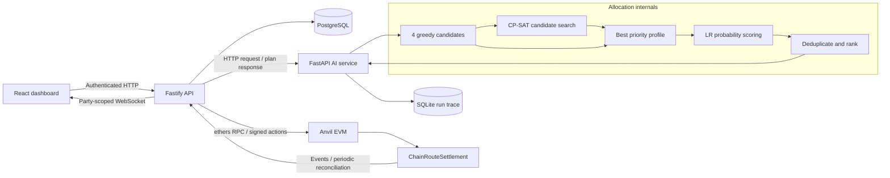
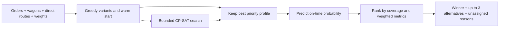
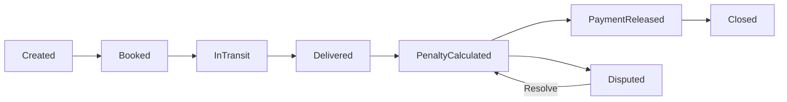

# ChainRoute: visual asset plan

**27 October 2026 — planning and existing-asset inspection only.** No deck or replacement application UI has been generated. Follow [the six-slide draft](SIH_6_SLIDE_CONTENT.md) and [research limitations](SIH_PROJECT_RESEARCH.md) when producing approved assets.

## 1. Actual screenshots and template assets

These are genuine saved browser images from the local synthetic validation stack. They are not proof that today's working tree is healthy. The browser report is dated **26 October 2026, 06:34 UTC**, and includes a dashboard-summary HTTP 500 despite its top-level `passed` flag. Existing captures use 1280-, 768- and 375-pixel viewports; they are often **full-page tall images**, not slide-sized frames.

| Asset / slide | Actual file or route | What to show | Capture/use qualification |
|---|---|---|---|
| Planning workflow, slide 2 | `artifacts/integration/browser/orders-1280.png`; `/orders`; `dashboard/src/app/OrdersPage.tsx` | A few freight rows with cargo, quantity, priority and deadline | Inspect the selected crop before production. Do not imply these are actual customers or SAIL dispatch records. |
| Allocation output, optional slide 2 | `artifacts/integration/browser/allocations-1280.png`; `/allocations`; `dashboard/src/app/OptimizationPage.tsx` | Selected assignment, unassigned reason and metric labels | Crop only populated result areas; never replace an unrun result with invented numbers. |
| AI explanation, slide 3 or rehearsal | `artifacts/integration/browser/ai-lab-1280.png`; `/ai-lab`; `dashboard/src/app/AiLabPage.tsx` | Real teaching interface and method sequence | **Visually reviewed.** The saved image shows controls and explanation; it does not show a completed CP-SAT result. The lower accuracy section is beyond the main initial viewport. Use JSON evidence for a result chart. |
| Settlement, slides 2/5 | `artifacts/integration/browser/shipper-settlement-1280.png`; `/contracts/1` **in that validation stack**; `dashboard/src/app/ContractsPage.tsx` | Bottom settlement breakdown, or a separate state-history crop | **Visually reviewed.** Shows Closed, ₹25,000 freight, ₹1,500 penalty, ₹240 demurrage, ₹23,260 net. Crop into legible panels; the full 2510-pixel-tall page is too dense for one slide. Contract IDs can differ in the main stack. |
| Blockchain evidence, optional slide 4 inset | `artifacts/integration/browser/blockchain-1280.png`; `/blockchain`; `dashboard/src/app/BlockchainPage.tsx` | Two or three linked blocks plus selected block timestamp/hash | **Visually reviewed.** The selected block #50 is labelled empty. Do not call it a settlement transaction. Chain dates can be ahead of wall time because tests advance the development clock. |
| Role/admin functionality, supporting evidence | `admin-1280.png`, `admin-resources-1280.png`, `audit-1280.png`, `plans-1280.png` in the same browser directory | Allowed actions, resource rows, saved records | Keep off the six main slides unless needed for a judge question. Inspect before use; do not turn 12 screens into a thumbnail collage. |
| Overview | `artifacts/integration/browser/overview-1280.png`; `/overview` | Reserved for a later clean capture | **Do not use as a healthy-system hero.** Known summary-query failure must first be fixed and verified in a separately authorized implementation task. |
| Responsive support | Corresponding `*-768.png` and `*-375.png` | One focused mobile crop, if requested | Existing evidence only; not a substitute for final keyboard/reduced-motion review. |
| Supplied template | `C:/Users/hp/Downloads/ChainRoute.pdf` | Six page frames/headings and observed branding regions | All pages reviewed. SIH2026/SatQuery fields conflict with this task; never reuse their identity values. |
| Comparison template | `C:/Users/hp/Downloads/SIH Sample PPT.pdf` | Readability/structure reference only | All pages reviewed. Filled YuvaSetu example; not ChainRoute evidence or an official blank-template certification. |
| Inspection renders | `artifacts/sih-research/chainroute-1.png` … `chainroute-6.png`; `sih-template-1.png` … `sih-template-6.png` | Review layout without modifying originals | Already rendered locally, not submission deliverables. Text extracts are `chainroute.txt` and `sih-template.txt`. |

No screenshot should expose passwords, bearer/invitation tokens, `.env`, validation session files or private keys. Public development-chain hashes can remain if relevant. Add **“Synthetic local demonstration”** to screenshots used as results.

## 2. Architecture diagram

Use this content for slide 3, simplifying text labels to fit. These are the actual service relationships:



**Design:** For the actual slide, show five primary service boxes and make the AI internals a short three-stage inset. Label **PostgreSQL = operational records/cache**, **SQLite = AI trace**, **Anvil = local development chain**. Keep arrows directional; the API receives events by polling. Do not draw a direct browser/AI/chain triangle, message broker, external oracle or payment gateway.

**Evidence:** `docker-compose.yml`, `backend/src/app.ts`, `backend/src/orders/routes.ts`, `backend/src/contracts/{chain,sync}.ts`, `ai-engine/{app,allocator,run_log}.py`.

## 3. Optimization workflow and bottleneck diagram

Use for slide 5, with a simplified method strip on slide 3:



A separate tiny before/after allocation picture is more memorable than putting the full math on a slide:

| | Flexible order: Port-A | Restricted order: Port-B |
|---|---|---|
| Greedy | Takes Yard-B wagon | No available compatible wagon |
| Search-backed result | Uses Yard-A wagon | Uses Yard-B wagon |

Actual fixture: `samples/phase-6-scarce-demo.json` and `ai-engine/demo/cp-sat-case.json`. Each order is 20 t, each wagon 20 t, equal priority. Yard-A→Port-A is 20 km/3 h; Yard-B→Port-A and Yard-B→Port-B are 10 km/1 h. Draw **two orders and two wagons**, not an invented multi-train yard.

**Chart data:** served orders 1 versus 2, unserved 1 versus 0; selected-capacity fill 100% versus 100%; assumed cost ₹25 versus ₹75. Use a y-axis **0–2 orders**, or a direct paired pictogram. Do not truncate axes to exaggerate a large-fleet effect.

Do not chart historical heuristic **0.490→0.958** as current ML output. Its denominator includes the unserved order and its predictor predates LR. Do not label this example a utilization-rate or cost-saving gain.

## 4. ML result charts

Source of truth: `ai-engine/demo/evidence.json`, `evaluation`; training specification: `ai-engine/train_prediction_model.py`; parameters: `ai-engine/on_time_model.json`.

### Preferred compact comparison, slide 3

| Series | Accuracy (%) |
|---|---:|
| Always predict on time | 90.9166666667 |
| Logistic Regression, threshold 0.5 | 97.35 |

Use two bars with a **0–100% axis** and exact labels **90.92% / 97.35%**. A **6.43 percentage-point** annotation is valid; do not call it 6.43% relative improvement. Put **“Same-simulator synthetic holdout, n=6,000; training n=24,000”** next to the chart.

Show **probability MAE 0.00978** as a separately labelled number, not a third accuracy bar. The tolerance **0.10** is a developer gate, not a baseline predictor or industry target.

### Optional judge-question backup, not an extra main slide

Confusion matrix:

```text
                    predicted on time    predicted late
actual on time             5396                 59
actual late                 100                445
```

Late recall is **81.65%**; that is important context for the imbalanced 97.35% headline. F1 and ROC-AUC are not recorded and should not be invented. A probability illustration can show the saved grain predictions **51.81%, 88.30%, 98.15%** at slack **0, 0.25, 0.5**; label it **example inference**, never accuracy or a validated calibration curve.

## 5. Blockchain lifecycle and settlement assets

Use a miniature lifecycle on slide 2 or as a presentation backup:



Delivery and deduction calculation occur in one transaction. Release is an explicit operator action; **PaymentReleased is an accounting state**, not proof of funds transfer. Use neutral labels if the state name needs explanation.

For slide 5, the verified waterfall is:

| Stage | Paise | INR |
|---|---:|---:|
| Freight | 2,500,000 | 25,000 |
| Subtract delay penalty | −150,000 | −1,500 |
| Subtract demurrage | −24,000 | −240 |
| Net accounting payable | 2,326,000 | 23,260 |

Source: `blockchain/contracts/ChainRouteSettlement.sol`, the late scenario in `artifacts/integration/report.json`, and the inspected settlement screenshot. Supporting labels: 13 h late; 6 h penalty windows at 200 bps; 10 h held; 6 free h; 12 wagons; ₹5/wagon-hour. **Contractual penalty windows are unrelated to EVM block count.**

If an animated explanation is later approved, move existing genuine block cards along their parent links and clearly label **replay** versus **new block**. Do not manufacture a settlement transaction or equate mining an empty demonstration block with successful delivery. A static slide cannot prove consensus, immutability against the node owner or distributed production governance.

## 6. Read-only asset inspection commands and capture boundaries

The following PowerShell commands only inspect saved assets/data:

```powershell
Get-ChildItem -LiteralPath 'D:/Chainroute/artifacts/integration/browser' -Filter '*.png'
$sihMlEvidence = Get-Content -Raw -LiteralPath 'D:/Chainroute/ai-engine/demo/evidence.json' | ConvertFrom-Json
$sihMlEvidence.evaluation | Select-Object totalSamples, trainingSamples, testSamples, probabilityMae, accuracy, alwaysOnTimeAccuracy, lateRecall
$sihBrowserEvidence = Get-Content -Raw -LiteralPath 'D:/Chainroute/artifacts/integration/browser/report.json' | ConvertFrom-Json
$sihBrowserEvidence.failedApiRequests
```

For a later approved live capture, navigate to the existing application at `http://localhost:5173/ai-lab`, `/orders`, `/allocations`, `/contracts/<verified-id>` and `/blockchain`. An isolated validation stack may use **15173**, not 5173. `http://localhost:8000/demo/` is the standalone teaching interface. Authenticate using local configured accounts without including credentials in screenshots.

**Do not execute these as part of this research freeze:** `scripts/start-demo.ps1`, seed/reset/populate commands, `scripts/validate-integration.ps1`, `scripts/validate-acceptance.ps1`, `scripts/browser-acceptance.cjs`, ML training/evaluation regeneration, the “Run CP-SAT”/“Predict” buttons or “Add demonstration block.” These write operational records, AI traces, evidence files or chain state. Their source identifies how to obtain new evidence in a later implementation/demo task; saved artifacts suffice for the current approval draft.

When a clean recapture is authorized: first resolve the known summary SQL error, pin the source revision, verify the chosen stack and actual contract, capture 16:9 crops of real results, and retain the original plus date/revision/route/caption. Do not edit error banners out to imply a healthy run. If charts are generated later, use the exact saved numbers above and retain machine-readable data beside them.

## 7. Template, typography, citation and logo treatment

- Use the supplied exact section headings, including **IMPACTS AND BENEFITS**, until the matching official template is confirmed. Six slides total, title included.
- Keep mandatory branding/footer/page fields. Do not repaint an official template as a full application screenshot. Within permitted content regions, restrained evergreen, brass and rust accents can connect to the application's Yard Marks identity.
- Recommendation, **not an official rule**: body text around 22–26 pt, figure labels around 18–20 pt, short headers with a clear hierarchy. If content does not fit, shorten it; never force tiny diagrams into the footer.
- Use native vector diagram elements or SVG for approved slide production, not screenshots of source code. Reserve monospace for a short hash fragment, never full unreadable addresses.
- Slide 6 uses the six linked references in `SIH_6_SLIDE_CONTENT.md`; complete bibliography/access notes are in `SIH_PROJECT_RESEARCH.md`. DOI links are preferable to long raw publisher URLs on the slide.
- Use the repository's existing product mark. No invented SAIL partnership seal, customer logo, railway endorsement, AWS/Kubernetes stack, or winner badge. Official marks must come from the approved template/authorized source; the filled sample deck's logos are irrelevant.
- Do not cite the uninspected official PS card as if it were read. Keep institutional corroboration and official-portal access pending clearly distinguished.

## 8. Asset acceptance criteria

An approved production asset must be readable at slide size, state whether data is synthetic/local, match the saved units/denominators, and have a source file/route plus capture date. Diagrams must show the backend hub and ML reranking boundary. Screenshots must be genuine and free of credentials. Charts must distinguish probability, classification and accounting values. None of these assets implies final current-source acceptance or industrial impact validation.
